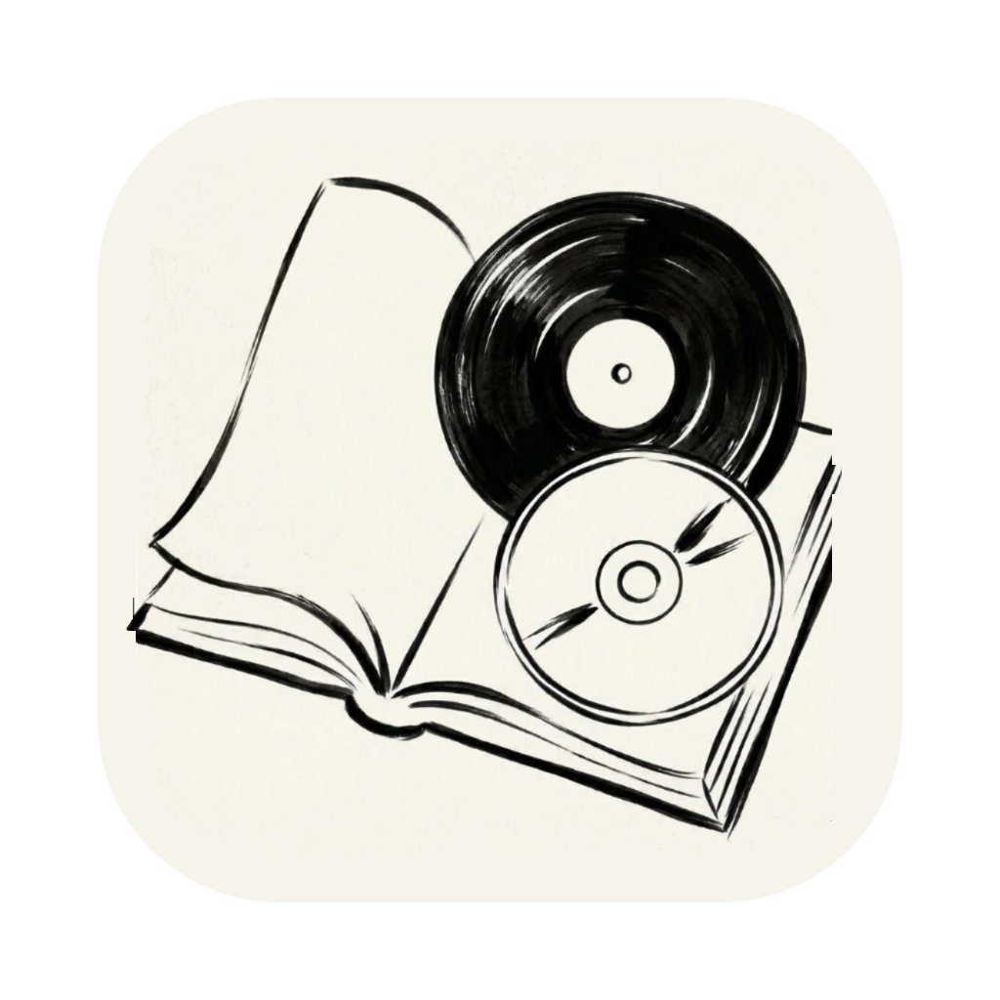

<p align="center">
  
</p>

<h1 align="center">Archivio</h1>

<p align="center">
  <strong>Il Catalogatore Domestico Definitivo per Libri, CD e Vinili</strong><br>
  <em>Versione 1.0.0 &nbsp;·&nbsp; macOS &nbsp;·&nbsp; Windows &nbsp;·&nbsp; Linux &nbsp;·&nbsp; Licenza GNU GPLv3</em>
</p>

<p align="center">
  <b>Italiano</b> &nbsp;·&nbsp; <a href="README_EN.md">English</a>
</p>

> **Catalogare la propria libreria o discoteca di casa non dovrebbe mai essere un lavoro lungo, noioso o pieno di errori.**  
> **Archivio** nasce con un unico obiettivo: **velocizzare, semplificare e rendere professionale ma immediata per chiunque la catalogazione del proprio archivio domestico di Libri, CD e Vinili**.

Che tu ti trovi davanti a **dieci scaffali di romanzi**, a **centinaia di CD accumulati negli anni** o a **casse di vinili d'epoca e ristampe da edicola in ordine sparso**, **Archivio** trasforma ore di inserimento manuale in pochi secondi:
- **Digiti poche lettere** (anche con refusi o errori di battitura), **oppure inserisci il codice ISBN / il codice a barre EAN-13 o UPC-12**, e l'app riconosce all'istante l'opera, ti propone prima i titoli più celebri e compila automaticamente **Titolo**, **Autore / Artista**, **Chiave di ordinamento per cognome**, **Casa Editrice / Etichetta Discografica**, **Collana / Collezione** e **Anno di uscita**.
- **Selezioni una Collana o un Box Set** e l'app aggiorna da sola l'Editore/Etichetta e l'Anno corrispondente, tenendo tutti i volumi della stessa collana ordinati e vicini tra loro.
- **I tuoi dati restano sempre tuoi**, salvati in semplici fogli **CSV** leggibili ovunque (Excel, Numbers, LibreOffice) ed esportabili in qualsiasi momento in eleganti cataloghi **PDF A4 pronti per la stampa**.

---

## 💾 Download e Installazione Multi-Piattaforma (Versione 1.0.0)

Tutti i pacchetti d'installazione vengono compilati e ottimizzati per ciascun sistema operativo:

| Sistema Operativo | Formato Disponibile | Download Diretto (`v1.0.0`) |
| :--- | :--- | :--- |
| 🍏 **macOS** *(Apple Silicon)* | Immagine disco `.dmg` con app trascinabile | 👉 **[Scarica Archivio-macOS.dmg](https://github.com/a-bit-are/archivio/releases/download/v1.0.0/Archivio-macOS.dmg)** |
| 🪟 **Windows** *(10 / 11 a 64 bit)* | Programma di installazione `.exe` (o `.zip` portatile) | 👉 **[Scarica Archivio-Windows-Setup.exe](https://github.com/a-bit-are/archivio/releases/download/v1.0.0/Archivio-Windows-Setup.exe)** • *[Zip portatile](https://github.com/a-bit-are/archivio/releases/download/v1.0.0/Archivio-Windows-Portable-x64.zip)* |
| 🐧 **Linux** *(Ubuntu, Debian, Fedora, Arch)* | Pacchetto universale `.AppImage` o pacchetto `.deb` | 👉 **[Scarica Archivio-Linux.AppImage](https://github.com/a-bit-are/archivio/releases/download/v1.0.0/Archivio-Linux-x86_64.AppImage)** • *[.deb](https://github.com/a-bit-are/archivio/releases/download/v1.0.0/archivio_1.0.0_amd64.deb)* |

### Come installare e aprire al primo avvio:

#### 🍏 macOS:
1. **Scarica** il file `Archivio-macOS.dmg` (disponibile sia nella sezione [Releases](https://github.com/a-bit-are/archivio/releases) sia direttamente nel repository).
2. **Apri il file `.dmg`** e trascina l'icona di **Archivio** nella cartella **Applicazioni**.
3. **Primo avvio:** fai **clic destro** (oppure Control-clic) sull'app **Archivio** nella cartella Applicazioni e seleziona **Apri**, quindi conferma premendo **Apri** (oppure da Terminale: `xattr -cr /Applications/Archivio.app`).

#### 🪟 Windows:
1. Scarica il programma di installazione **`Archivio-Windows-Setup.exe`** dalla tabella qui sopra o dalla sezione [Releases](https://github.com/a-bit-are/archivio/releases).
2. Fai doppio clic su `Archivio-Windows-Setup.exe` e segui l'installazione guidata: installerà **Archivio** sul PC aggiungendolo al **Menu Start**, sul **Desktop** e nelle **App installate** di Windows (con disinstallatore incluso). *(Se Windows SmartScreen mostra un avviso al primo avvio, clicca su «Ulteriori informazioni» → «Esegui comunque».)*

#### 🐧 Linux:
- **Con AppImage (consigliato su tutte le distribuzioni):**  
  Scarica `Archivio-Linux-x86_64.AppImage`, rendilo eseguibile (`chmod +x Archivio-Linux-x86_64.AppImage`) e fai doppio clic per aprirlo.
- **Con pacchetto Debian / Ubuntu:**  
  Scarica `archivio_1.0.0_amd64.deb` e installalo con `sudo dpkg -i archivio_1.0.0_amd64.deb`.

---

## Perché scegliere Archivio? (Lo scopo dell'App)

Quando si prova a catalogare a mano una collezione casalinga (su un foglio di calcolo o su programmi complessi pensati per bibliotecari professionisti), ci si scontra sempre con gli stessi problemi:
1. **Lentezza estrema:** dover scrivere a mano titolo completo, nome e cognome dell'autore, editore, collana e anno per centinaia di pezzi richiede settimane.
2. **Disordine nell'ordinamento alfabetico:** mettere in ordine per cognome autori come *Fabrizio De André*, *Giuseppe Tomasi di Lampedusa*, *Gabriel García Márquez* insieme a band come *Pink Floyd*, *The Beatles* o artisti come *Sting* costringe a trucchi manuali continui.
3. **Confusione tra edizioni, ristampe e formati fisici:** un CD non può avere come anno di stampa il 1973 (il formato CD è nato nel 1982!) né un'etichetta esclusivamente da vinile; un romanzo nei *Supercoralli Einaudi* non ha lo stesso anno dell'edizione tascabile negli *Oscar Mondadori*.
4. **Il problema delle Collane e delle Collezioni:** su uno scaffale reale, i volumi di una stessa collana (es. *I Meridiani*, *Piccola Biblioteca Adelphi*, *DeAgostini Jazz in Vinile*, *Classici #1, #2, #3*) stanno **vicini tra loro** anche se scritti da autori diversi, ma nei normali programmi finiscono sparsi in tutto l'elenco.

**Archivio risolve automaticamente tutti questi problemi con un'interfaccia minimale, intuitiva e pensata per essere usata da chiunque sin dal primo secondo su macOS, Windows e Linux.**

---

## Tutte le Funzioni di Archivio nel Dettaglio

### 1. Configurazione Iniziale Professionale e Multilingua (Italiano / English)
- **Finestra di Benvenuto al Primo Avvio:** quando avvii **Archivio** per la prima volta, l'applicazione non crea file o cartelle nascoste a tua insaputa. Si apre una finestra di benvenuto pulita (in **Inglese** di default, commutabile istantaneamente in **Italiano** con un clic) che ti permette di:
  - Scegliere la **lingua dell'interfaccia** (*Italiano* / *English*).
  - Scegliere o confermare la **Cartella di riferimento dell'Archivio** (di default `~/Documents/Archivio`, ma puoi scegliere qualsiasi cartella sul tuo computer, su iCloud Drive, Dropbox, OneDrive o su un SSD esterno).
- Puoi cambiare lingua o cartella di riferimento in qualsiasi momento dalla barra laterale (`Cambia cartella…`) o dalle **Impostazioni** (`⌘,` su Mac / `Ctrl+,` su Windows e Linux).

### 2. Tre Ambienti Dedicati: 📚 Libri, 💿 CD e 🎵 Vinili
Ogni categoria ha regole bibliografiche e discografiche su misura:
- **📚 Libri:** mostra e gestisce *Titolo*, *Autore*, *Ordina come (Cognome, Nome)*, *Editore*, *Collana* e *Anno di pubblicazione*.
- **💿 CD:** mostra e gestisce *Titolo*, *Artista / Gruppo*, *Ordina come*, *Etichetta Discografica*, *Collezione / Box Set* e *Anno di stampa CD*. Filtra rigorosamente le uscite fisiche su **CD / SACD / HDCD (dal 1982 a oggi)**, escludendo vinili o cassette.
- **🎵 Vinili:** mostra e gestisce *Titolo*, *Artista / Gruppo*, *Ordina come*, *Etichetta Discografica*, *Collezione / Box Set* e *Anno di stampa LP/Vinile*. Filtra esclusivamente le stampe su **Vinile (`LP`, `12"`, `7"`, `180g`, dal 1948 a oggi)**.
- **Passaggio istantaneo:** puoi passare tra Libri (`⌘1` / `Ctrl+1`), CD (`⌘2` / `Ctrl+2`) e Vinili (`⌘3` / `Ctrl+3`) con un clic o da tastiera; ad ogni cambio categoria i campi di inserimento si azzerano in modo pulito senza lasciare residui.

### 3. Autocompletamento Intelligente Ultra-Veloce e Tollerante agli Errori
Mentre digiti nel campo **Titolo** o nel campo **Autore / Artista**, **Archivio** combina in tempo reale 3 livelli di ricerca:
1. **Livello 1 — Istantaneo Locale (`< 2 millisecondi`, funziona anche senza Internet):**
   - Cerca simultaneamente nei volumi già presenti nel tuo archivio, in un **catalogo integrato in memoria** di oltre **6.600 capolavori letterari** e **3.400 album storici** e nella cache locale SQLite.
   - Include il motore **RapidFuzz C++** tollerante agli errori di battitura: se scrivi per sbaglio `punk floyd`, `garcia marquez`, `dostoevskij` o `summoners tales`, l'app capisce comunque cosa intendi e ti propone il risultato esatto.
2. **Livello 2 — Ricerca Online Parallela Multi-Motore (`~200–350 ms`):**
   - **Per i Libri:** interroga contemporaneamente **OPAC SBN** (*Servizio Bibliotecario Nazionale Italiano - ICCU*), **Google Books API** e **Open Library**, garantendo una copertura totale sia dei libri italiani (inclusi editori storici e contemporanei) sia internazionali.
   - **Per CD e Vinili:** interroga contemporaneamente **Apple iTunes Search API**, **MusicBrainz / ListenBrainz** e (opzionalmente) **Discogs API**.
3. **Priorità Automatica per Popolarità:**
   - I suggerimenti sono ordinati per rilevanza e popolarità reale: i grandi classici, gli album ufficiali in studio e le opere principali compaiono **sempre in cima** rispetto a edizioni scolastiche, saggi critici, singoli o bootleg.

### 4. Filtro Contestuale Intelligente (Artista ↔ Titolo)
Non devi seguire un ordine fisso quando inserisci i dati:
- **Dal Titolo all'Autore:** se inizi a scrivere il titolo (es. `Il nome della rosa` o `The Wall`), il menu a tendina ti mostra l'opera completa di autore/artista, editore/etichetta e anno.
- **Prima l'Artista/Autore, poi il Titolo:** se stai catalogando una pila di dischi o libri dello stesso autore, puoi scrivere prima `Pink Floyd` (o `Italo Calvino`) nel campo **Artista / Autore**: appena ti sposti nel campo **Titolo** (o modifichi il titolo esistente scrivendo ad esempio `the`), **Archivio filtra automaticamente i suggerimenti proponendoti solo gli album dei Pink Floyd** (*The Dark Side of the Moon*, *The Wall*, *The Division Bell*, *The Final Cut*, *The Piper at the Gates of Dawn*).

### 5. Catalogazione Istantanea tramite Codice ISBN (Libri) e Barcode EAN / UPC (CD e Vinili)
Non c'è nemmeno bisogno di digitare il titolo se hai il volume o il disco in mano:
- **📚 Codice ISBN-10 o ISBN-13 per i Libri:**
  - Digita (o scansiona con un qualsiasi lettore barcode USB/Bluetooth) il codice ISBN a 10 o 13 cifre direttamente nel campo **Titolo** (es. `9788804668237`).
  - L'app interroga l'OPAC del **Servizio Bibliotecario Nazionale (SBN)**, Google Books e Open Library e compila **quella specifica edizione fisica**: *Titolo*, *Autore*, *Ordina come*, *Casa Editrice esatta*, *Collana editoriale con eventuale numero di volume* (es. `Oscar moderni #36`) e *Anno di quell'edizione*, contrassegnando il suggerimento con `[ISBN • Online]`.
- **💿🎵 Codice a barre EAN-13 (13 cifre) o UPC-12 (12 cifre) per CD e Vinili:**
  - I codici a barre **EAN** (13 cifre, standard europeo/italiano) e **UPC** (12 cifre, standard USA/Canada) fanno parte dello standard mondiale unificato **GS1** e sono stampati sul retro di praticamente tutti i CD e dei vinili prodotti dal 1980 a oggi.
  - Digitando o scansionando il codice EAN o UPC nel campo **Titolo** di **CD** o **Vinili** (es. `5099902895529` o `731454007023` o `888837168618`), **Archivio** converte automaticamente tra formato UPC a 12 cifre ed EAN a 13 cifre e individua **l'esatta stampa fisica che hai tra le mani**, compilando automaticamente l'**Etichetta discografica di quella stampa** (es. `Parlophone`, `A&M Records`, `Columbia`) e l'**Anno esatto di quella ristampa**, contrassegnando il risultato con `[EAN/UPC • Online]`.
- **Scanner Remoto da Dispositivo Mobile (`Scansiona da dispositivo mobile` / `⌘B` o `Ctrl+B` — macOS, Windows e Linux):**
  - Cliccando sul pulsante **`Scansiona da dispositivo mobile`** (`⌘B` / `Ctrl+B`), **Archivio** mostra un **QR Code di sessione** (`ARCH-XXXX-XXXX`) collegato direttamente a **GitHub Pages Ufficiale (`docs/scanner.html`)** in HTTPS sicuro (senza siti o tunnel terzi) e alla rete Wi-Fi locale.
  - Inquadrando il QR Code con qualsiasi **smartphone o tablet (iOS / Android / iPadOS)** senza installare alcuna app e anche sotto rete cellulare **4G/5G**, il dispositivo mobile diventa uno scanner dedicato dotato di **5 accorgimenti professionali**:
    1. **Scanner Live HTTPS + Zoom Macro (`1.5x` / `2x`) e Torcia:** evita le ombre e la sfocatura da vicino sulle barre e resta sempre aperto dopo ogni acquisizione.
    2. **Scatto Foto Antiriflesso:** elimina i riflessi del cellophane sulle custodie in plastica dei CD e sulle buste dei vinili grazie al filtro antiriflesso e alla lettura delle cifre stampate.
    3. **Riconoscimento Codici Periodici da Edicola (`ISSN 977`):** distingue automaticamente i codici `977` delle uscite da edicola (*Urania*, *Classici*, *DeAgostini Jazz in Vinile*) dai veri ISBN `978/979`, pre-impostando la collana e avvisando l'utente di fotografare il titolo.
    4. **Modalità Senza Barcode (`OCR Copertina / Frontespizio / Etichetta LP`):** per i libri stampati prima del 1970 e i vinili d'epoca (1948–1979) privi di codice a barre, legge Titolo e Autore proponendo subito le edizioni sullo schermo del dispositivo mobile.
    5. **Modalità Raffica da Scaffale e Anteprima sul Dispositivo Mobile:** mostra immediatamente lo stato di ricerca accanto al codice acquisito, l'anteprima completa (*Titolo, Autore, Editore, Collana, Anno*), l'avviso in caso di duplicato, il blocco fisso della Collana e i pulsanti **`Aggiungi in Archivio`** e **`Annulla`**.
- **Fotocamera del Computer Diretta (`Fotocamera del computer` / `⌘⇧B` o `Ctrl+Shift+B` — macOS, Windows e Linux):**
  - Cliccando sul pulsante **`Fotocamera del computer`** (`⌘⇧B` su macOS, `Ctrl+Shift+B` su Windows e Linux) nella scheda *Nuovo inserimento*, **Archivio** apre direttamente la webcam integrata o esterna del computer:
    - Inquadra il codice a barre e premi `Spazio` o **`Acquisisci codice`** (oppure attiva l'acquisizione automatica o la **Modalità Raffica**), confermando l'inserimento direttamente dalla scheda di anteprima integrata con **`Aggiungi in Archivio (Invio)`** senza mai chiudere la fotocamera.
    - Per i volumi e i dischi senza codice a barre, **`Scatta foto copertina (OCR)`** ferma l'inquadratura per verificarne la leggibilità (`Riscatta` oppure `Cerca nel catalogo da questa foto`) e individua Titolo e Autore tramite il motore OCR nativo di sistema (Apple Vision su macOS, Windows Media OCR su Windows 10/11, Tesseract su Linux).

### 6. Gestione Completa di Collane, Collezioni e Box Set (con Auto-Correzione di Editore e Anno)
- **Menu a tendina delle Collane sempre contestuale:**
  - Per i **Libri**, il campo **Collana** propone sia le collane reali in cui il libro è stato pubblicato (estratte da OPAC SBN / Google Books / Open Library), sia tutte le collane storiche della casa editrice selezionata (es. *I Meridiani*, *Oscar moderni*, *Oscar classici* per **Mondadori**; *Supercoralli*, *I Coralli*, *ET Scrittori*, *Gli Struzzi* per **Einaudi**; *Biblioteca Adelphi*, *Piccola Biblioteca Adelphi* per **Adelphi**; *BUR Classici* per **BUR Rizzoli**, ecc.).
  - Per **CD e Vinili**, il campo **Collezione** propone solo le serie e i cofanetti compatibili con il **formato attivo** e con l'**artista** inserito (es. `Discovery Edition`, `Experience Edition`, `Immersion Box Set` compaiono solo per i *Pink Floyd*; `DeAgostini Jazz in Vinile` e `Blue Note Tone Poet Series` compaiono solo in *Vinili*).
- **Aggiornamento automatico di Editore/Etichetta e Anno alla scelta della Collana:**
  - Selezionando una **Collana / Collezione** dal menu a tendina, **Archivio corregge automaticamente l'Editore / Casa Discografica e l'Anno di pubblicazione** associati a quella collana:
    - Selezioni `Discovery Edition` su un CD dei Pink Floyd → l'etichetta diventa automaticamente **`EMI`** e l'anno **`2011`**.
    - Selezioni `DeAgostini Jazz in Vinile` su un LP → l'etichetta diventa **`DeAgostini`** e l'anno **`2016`**.
    - Selezioni `Supercoralli` o `Oscar Mondadori` su un libro di Calvino → l'editore diventa rispettivamente **`Einaudi`** o **`Mondadori`** e l'anno si allinea all'edizione di quella casa editrice.
- **Spunta `☑ Raggruppa Collane / Collezioni a parte` (disattivata di default, con ordine alfabetico per Autore A-Z):**
  - **Di default (spunta disattivata):** l'intero catalogo segue il normale e lineare ordine alfabetico A-Z per autore (cognome), posizionando ciascun volume al suo posto naturale senza spezzare l'elenco.
  - **Quando attivi la spunta:** tutti i volumi o dischi che appartengono alla stessa Collana vengono **tenuti vicini tra loro** e ordinati a parte per nome della collana e, all'interno della collana, per **numero di volume** (supporta sia numeri arabi `#1, #2, #10` sia numeri romani `Vol. I, Vol. II, Vol. III`) e poi per autore. Così, se hai un'edizione in 2 volumi con *Dickens* (Vol. I) e *Shakespeare* (Vol. II), restano fianco a fianco proprio come sullo scaffale di casa.

### 7. Ordinamento Intelligente per Cognome e Nome d'Arte (`Ordina come`)
Il campo **`Ordina come`** viene calcolato in automatico mentre scrivi l'autore o l'artista, seguendo le regole bibliografiche italiane e internazionali:
- **Autori e cantautori con particelle nobiliari o cognominali:** `Fabrizio De André` → `De André, Fabrizio`; `Francesco De Gregori` → `De Gregori, Francesco`; `Giuseppe Tomasi di Lampedusa` → `Tomasi di Lampedusa, Giuseppe`; `Gabriel García Márquez` → `García Márquez, Gabriel`; `Pietro di Donato` → `di Donato, Pietro`; `Ludwig van Beethoven` → `van Beethoven, Ludwig`.
- **Riconoscimento automatico di Cognome + Nome invertiti:** se digiti `Allevi Giovanni` o `De Sanctis Francesco` (prima il cognome e poi il nome), l'app riconosce l'inversione e genera correttamente `Allevi, Giovanni` e `De Sanctis, Francesco`.
- **Gruppi musicali, band e nomi d'arte:** `Pink Floyd` resta `Pink Floyd` (non viene mai invertito in *"Floyd, Pink"*), `The Beatles` diventa `Beatles, The`, `Sting` resta `Sting`.
- **Sempre personalizzabile:** se per un caso particolare preferisci un ordine diverso, puoi modificare liberamente il campo `Ordina come` prima o dopo l'inserimento.

---

## Guida Pratica: Come usare Archivio passo dopo passo

### Passo 1 — Inserire un Libro, un CD o un Vinile
1. Scegli la categoria nella barra laterale sinistra (**Libri**, **CD** o **Vinili**).
2. Posizionati nel campo **Titolo** (oppure in **Autore / Artista**):
   - **Metodo A (per Titolo o Autore):** inizia a digitare qualche lettera. Usa le frecce `↓` / `↑` e premi `Invio` (oppure clicca con il mouse) per selezionare l'opera dal menu dei suggerimenti.
   - **Metodo B (con codice ISBN o Barcode EAN/UPC):** digita o scansiona le 10/13 cifre dell'ISBN (per un libro) o le 12/13 cifre del codice a barre EAN/UPC (per un CD o un vinile) nel campo **Titolo** e premi `Invio` sul suggerimento proposto.
3. Verifica o scegli dal menu a tendina l'**Editore / Etichetta**, l'eventuale **Collana / Collezione** e l'**Anno**.
4. Premi il pulsante **`Aggiungi`** (oppure premi direttamente `Invio` da qualsiasi campo). L'elemento viene inserito e posizionato automaticamente nel punto esatto dell'elenco.

### Passo 2 — Gestire più Fogli (CSV) per la stessa Categoria
Vuoi tenere separati i libri del salotto da quelli dello studio, o i CD Jazz da quelli Rock?
- Nella barra laterale sinistra, sotto **FOGLIO ATTIVO**, trovi il menu a tendina con tutti i file CSV della categoria corrente (es. `libri.csv`, `libri_studio.csv`, `cd_jazz.csv`).
- Clicca su **`+ Nuovo foglio vuoto`** o su **`Salva con nome…`** per creare un nuovo archivio tematico: l'app aggiunge da sola il prefisso corretto (`libri_`, `cd_`, `vinili_`) per riconoscere sempre a quale categoria appartiene il file.

### Passo 3 — Cercare, Modificare, Assegnare Collane e Annullare (`Undo / Redo`)
- **Ricerca istantanea (`⌘F` / `Ctrl+F`):** scrivi nella casella *Filtra nell'archivio* in alto a destra per filtrare istantaneamente la tabella per titolo, autore, editore, collana o anno.
- **Modifica rapida:** fai **doppio clic** su qualsiasi riga della tabella (oppure premi `Modifica…` / `⌘E` o `Ctrl+E`) per aprire la finestra di modifica completa con tutti gli editori, le collane e gli anni disponibili per quell'opera.
- **Assegnazione rapida a una Collana (`⌘G` / `Ctrl+G` o clic destro):** puoi selezionare anche **più righe contemporaneamente**, fare **clic destro → Assegna a Collana / Collezione…** e assegnare tutti i volumi selezionati alla stessa collana in un solo colpo.
- **Annulla / Ripristina illimitato (`⌘Z` / `Ctrl+Z`):** hai eliminato o modificato una riga per errore? Premi `Annulla` in basso o da tastiera per tornare immediatamente allo stato precedente.

### Passo 4 — Salvare i CSV ed Esportare i Cataloghi in PDF
- **`Salva` (`⌘S` / `Ctrl+S`) / `Salva tutti` (`⌥⌘S` / `Ctrl+Alt+S`):** salva i file CSV con **scrittura atomica sicura** (nessun rischio di file corrotti nemmeno in caso di spegnimento improvviso del computer) e crea automaticamente una copia di sicurezza datata nella cartella `Backups` di sistema (`~/Library/Application Support/Archivio/Backups/` su macOS, `%APPDATA%\Archivio\Backups\` su Windows, `~/.config/archivio/Backups/` su Linux, mantenendo gli ultimi 20 backup).
- **`Esporta PDF` (`⌘P` / `Ctrl+P`):** genera in un istante un catalogo **PDF A4 vettoriale ad alta definizione (300 DPI)** della categoria attiva, impaginato con intestazione, conteggio totale dei volumi, raggruppamento delle collane e numerazione delle pagine.

---

## Token Discogs Opzionale (Cos'è e come funziona)

**Archivio** funziona già al 100% appena installato senza bisogno di alcuna registrazione o chiave API (grazie a *OPAC SBN*, *Google Books*, *Open Library*, *Apple iTunes* e *MusicBrainz*).

Tuttavia, per chi colleziona **stampe rare in vinile, edizioni da edicola italiane o tirature limitate**, nelle **Impostazioni** è presente il campo opzionale **Token Discogs**:
- **A cosa serve:** permette ad **Archivio** di interrogare in parallelo anche il database mondiale di **Discogs**, arricchendo ulteriormente le etichette discografiche, i numeri di catalogo e il riconoscimento dei codici a barre EAN/UPC su CD e Vinili.
- **Come ottenerlo gratuitamente in 30 secondi:**
  1. Accedi (o registrati gratis) su [discogs.com](https://www.discogs.com).
  2. Vai su **Impostazioni → Sviluppatori** ([discogs.com/settings/developers](https://www.discogs.com/settings/developers)).
  3. Clicca sul pulsante **`Genera nuovo token`** (*Generate new token*).
  4. Copia il codice alfanumerico e incollalo in **Archivio → Impostazioni → Token Discogs**.

---

## Scorciatoie da Tastiera (macOS / Windows & Linux)

| Scorciatoia macOS | Scorciatoia Windows / Linux | Azione |
| :--- | :--- | :--- |
| `Invio` | `Invio` | Accetta il suggerimento selezionato o aggiunge l'elemento in archivio |
| `↓` / `↑` / `Esc` | `↓` / `↑` / `Esc` | Naviga o chiude il menu dei suggerimenti in tempo reale |
| `⌘1` / `⌘2` / `⌘3` | `Ctrl+1` / `Ctrl+2` / `Ctrl+3` | Passa istantaneamente a **Libri**, **CD** o **Vinili** |
| `⌘N` | `Ctrl+N` | Pulisce i campi e posiziona il cursore su **Titolo** per un nuovo inserimento |
| `⌘B` | `Ctrl+B` | Apre la finestra **Scansiona da dispositivo mobile** (QR Code GitHub Pages HTTPS, 4G/5G & Wi-Fi) |
| `⌘⇧B` | `Ctrl+Shift+B` | Apre la finestra **Fotocamera del computer** (codici a barre + OCR copertine) |
| `⌘F` | `Ctrl+F` | Cerca e filtra istantaneamente nella tabella |
| `⌘E` / `Doppio clic` | `Ctrl+E` / `Doppio clic` | Modifica l'elemento selezionato |
| `⌘G` / `Clic destro` | `Ctrl+G` / `Clic destro` | Assegna gli elementi selezionati a una Collana / Collezione |
| `⌘⌫` | `Ctrl+Backspace` | Elimina gli elementi selezionati |
| `⌘Z` / `⇧⌘Z` | `Ctrl+Z` / `Ctrl+Shift+Z` | Annulla / Ripristina l'ultima operazione |
| `⌘S` / `⌥⌘S` | `Ctrl+S` / `Ctrl+Alt+S` | Salva il foglio attivo / Salva tutti i fogli CSV |
| `⌘P` | `Ctrl+P` | Esporta il PDF della categoria attiva |
| `⌘,` | `Ctrl+,` | Apre la finestra **Impostazioni** |

---

## Struttura del Repository

```text
archivio/
├── Archivio-macOS.dmg                  # Installer macOS pronto per il download rapido
├── LICENSE                             # Licenza GNU GPLv3 (Copyright © 2026 Antonio Cafaro)
├── README.md                           # Guida completa all'uso e documentazione in italiano
├── README_EN.md                        # Documentazione completa in lingua inglese (English)
├── requirements.txt                    # Dipendenze Python (PySide6-Essentials, rapidfuzz, qrcode, pillow)
├── .github/
│   └── workflows/
│       └── build-and-release.yml       # Build e rilascio automatico multi-piattaforma (Windows, Linux, macOS)
├── assets/
│   ├── archivio.icns                   # Icona macOS Retina (16×16 → 1024×1024 con trasparenza Alpha)
│   ├── archivio.png                    # Icona master 1024×1024 PNG lossless con angoli trasparenti
│   ├── archivio.jpg                    # Icona 1024×1024 JPEG standard
│   └── archivio.ico                    # Icona Windows multi-risoluzione standard .ico
├── docs/
│   ├── scanner.html                    # Web-App mobile HTTPS (servita tramite GitHub Pages)
│   └── index.html                      # Redirect automatico allo scanner mobile
├── app/
│   ├── libreria.py                     # Entry-point principale dell'applicazione
│   └── archivio/                       # Package principale
│       ├── __init__.py                 # Metadati applicazione e versione (1.0.0)
│       ├── catalog.py                  # Motore di ricerca ibrido offline/online, ISBN, EAN/UPC e Collane
│       ├── config.py                   # Configurazione persistente e percorsi multi-piattaforma
│       ├── i18n.py                     # Localizzazione completa Italiano / English
│       ├── pdf_export.py               # Generatore PDF vettoriale A4 a 300 DPI
│       ├── remote_scanner.py           # Server locale, Cloud Relay, QR multi-piattaforma e Apple Vision
│       ├── store.py                    # Modello dati, I/O CSV atomico, backup e ordinamento Collane
│       ├── textutil.py                 # Normalizzazione testuale, cognomi e numeri romani/arabi di collana
│       ├── ui.py                       # Interfaccia nativa Qt6 da studio monocromatico
│       └── data/                       # Indici compressi pre-compilati e risorse integrate
├── tools/
│   ├── archivio_windows_installer.iss  # Script Inno Setup per il programma d'installazione Windows (.exe)
│   ├── build_macos_app.sh              # Compila il bundle nativo "dist/Archivio.app"
│   ├── build_dmg.sh                    # Genera l'installer "dist/Archivio-macOS.dmg"
│   ├── update_icon.sh                  # Aggiorna l'icona "assets/archivio.icns" da un file .png, .jpg o .icns
│   ├── vision_scanner.swift            # Sorgente Swift dell'helper nativo Apple Vision (Barcode + Live Text OCR + QR)
│   └── build_seed_index.py             # Ricostruisce gli indici offline pre-compilati
└── tests/
    ├── test_*.py                       # Suite di unit test automatici (unittest)
    └── simulate_human_cataloging.py    # Simulazione end-to-end di catalogazione utente
```

---

## Avvio da Sorgente e Compilazione Locale

### 1. Avvio rapido da codice sorgente (macOS, Linux, Windows)
Richiede **Python 3.10+**:

```bash
# macOS / Linux
python3 -m venv .venv
.venv/bin/python -m pip install -r requirements.txt
.venv/bin/python app/libreria.py
```

```powershell
# Windows (PowerShell)
python -m venv .venv
.\.venv\Scripts\python.exe -m pip install -r requirements.txt
.\.venv\Scripts\python.exe app\libreria.py
```

### 2. Compilazione dell'Applicazione nativa macOS (`Archivio.app` e `Archivio-macOS.dmg`)
Per generare l'applicazione macOS standalone in `dist/Archivio.app` e il relativo disco d'installazione `.dmg`:

```bash
bash tools/build_macos_app.sh
bash tools/build_dmg.sh
```

---

## Licenza e Autore

**Autore:** Antonio Cafaro (`Copyright © 2026 Antonio Cafaro`)  
**Licenza:** Distribuito sotto licenza libera **GNU General Public License v3.0 (GPLv3)**.

Qualsiasi modifica, ridistribuzione o opera derivata deve mantenere il codice sorgente aperto con la medesima licenza **GPLv3** e conservare l'attribuzione di paternità all'autore originale (**Antonio Cafaro**). Consulta il file [LICENSE](LICENSE) per il testo integrale della licenza.
