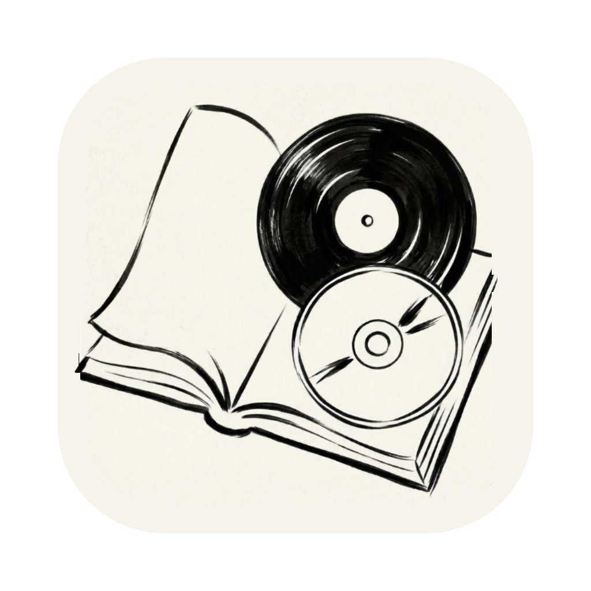

<p align="center">
  
</p>

<h1 align="center">Archivio</h1>

<p align="center">
  <strong>The Ultimate Home Cataloger for Books, CDs, and Vinyl Records</strong><br>
  <em>Version 1.0.0 &nbsp;·&nbsp; macOS &nbsp;·&nbsp; Windows &nbsp;·&nbsp; Linux &nbsp;·&nbsp; GNU GPLv3 License</em>
</p>

<p align="center">
  <a href="README.md">Italiano</a> &nbsp;·&nbsp; <b>English</b>
</p>

> **Cataloging your home library or music collection should never be a slow, tedious, or frustrating chore.**  
> **Archivio** is built with a single purpose: **to make cataloging your personal collection of Books, CDs, and Vinyl Records fast, seamless, and professional yet accessible to anyone**.

Whether you are facing **shelves filled with novels**, **hundreds of CDs gathered over the years**, or **crates of vintage vinyl records and newsstand reissues in mixed order**, **Archivio** turns hours of manual data entry into seconds:
- **Type just a few letters** (even with typos or spelling mistakes), **or enter an ISBN or EAN-13 / UPC-12 barcode**, and the app instantly identifies the work, presents the most notable titles first, and automatically fills in **Title**, **Author / Artist**, **Surname sort key**, **Publisher / Record Label**, **Series / Collection**, and **Release Year**.
- **Select a Series or Box Set**, and the app automatically updates the corresponding Publisher/Label and Year, keeping all volumes of the same series grouped together.
- **Your data always stays yours**, saved in standard **CSV** spreadsheets readable anywhere (Excel, Numbers, LibreOffice) and exportable at any time into clean, publication-ready **A4 PDF catalogs**.

---

## 💾 Multi-Platform Download & Installation (v1.0.0)

All packages are compiled and optimized specifically for each operating system:

| Operating System | Available Format | Direct Download (`v1.0.0`) |
| :--- | :--- | :--- |
| 🍏 **macOS** *(Apple Silicon)* | Disk image `.dmg` with drag-and-drop installer | 👉 **[Download Archivio-macOS.dmg](https://github.com/a-bit-are/archivio/releases/download/v1.0.0/Archivio-macOS.dmg)** |
| 🪟 **Windows** *(10 / 11 64-bit)* | Setup Installer `.exe` (or portable `.zip`) | 👉 **[Download Archivio-Windows-Setup.exe](https://github.com/a-bit-are/archivio/releases/download/v1.0.0/Archivio-Windows-Setup.exe)** • *[Portable Zip](https://github.com/a-bit-are/archivio/releases/download/v1.0.0/Archivio-Windows-Portable-x64.zip)* |
| 🐧 **Linux** *(Ubuntu, Debian, Fedora, Arch)* | Universal `.AppImage` or `.deb` package | 👉 **[Download Archivio-Linux.AppImage](https://github.com/a-bit-are/archivio/releases/download/v1.0.0/Archivio-Linux-x86_64.AppImage)** • *[.deb](https://github.com/a-bit-are/archivio/releases/download/v1.0.0/archivio_1.0.0_amd64.deb)* |

### How to Install and Open:

#### 🍏 macOS:
1. **Download** `Archivio-macOS.dmg` (from the table above or the [Releases](https://github.com/a-bit-are/archivio/releases) page).
2. **Open the `.dmg` file** and drag the **Archivio** icon into your **Applications** folder.
3. **First launch:** right-click (or Control-click) on **Archivio** in Applications and choose **Open**, then confirm by clicking **Open** (or run `xattr -cr /Applications/Archivio.app` in Terminal).

#### 🪟 Windows:
1. Download **`Archivio-Windows-Setup.exe`** from the table above or the [Releases](https://github.com/a-bit-are/archivio/releases) page.
2. Double-click `Archivio-Windows-Setup.exe` and follow the guided setup: it installs **Archivio** into your system, creates **Start Menu** and **Desktop** shortcuts, registers the app in Windows Installed Apps (with a full uninstaller included), and launches immediately. *(If Windows SmartScreen appears on first run, click "More info" → "Run anyway".)*

#### 🐧 Linux:
- **Using AppImage (recommended for all distributions):**  
  Download `Archivio-Linux-x86_64.AppImage`, make it executable (`chmod +x Archivio-Linux-x86_64.AppImage`), and double-click to run.
- **Using Debian / Ubuntu package:**  
  Download `archivio_1.0.0_amd64.deb` and install it with `sudo dpkg -i archivio_1.0.0_amd64.deb`.

---

## Why Choose Archivio? (The Purpose of the App)

When attempting to catalog a personal collection manually (in a generic spreadsheet or complex software designed for academic librarians), you always run into the same hurdles:
1. **Extreme slowness:** typing full titles, author names, publishers, collections, and years by hand for hundreds of items takes weeks.
2. **Alphabetical sorting chaos:** sorting authors like *Gabriel García Márquez*, *Fabrizio De André*, or *Giuseppe Tomasi di Lampedusa* alongside musical artists like *Pink Floyd*, *The Beatles*, or *Sting* leads to constant formatting headaches.
3. **Confusion between physical formats, editions, and reissues:** a CD cannot have 1973 as its release year (the CD format was introduced in 1982!) or carry a vinyl-exclusive catalog label; a paperback reissue does not share the year or publisher of an original hardcover.
4. **The Book Series & Music Collections dilemma:** on a real shelf, books in the same series (e.g., *Penguin Classics*, *Everyman's Library*, *Meridiani*, *Jazz on Vinyl*) sit **side by side** even when written by different authors. Standard cataloging software scatters them across the entire alphabet.

**Archivio solves all of these problems automatically with a clean, focused, studio-inspired interface that feels natural from the very first minute on macOS, Windows, and Linux.**

---

## Detailed Features

### 1. Professional Multi-Language Setup (English / Italian)
- **First-Run Welcome Dialog:** when you launch **Archivio** for the first time, it does not hide files or folders behind your back. A clean welcome screen appears (set to **English** by default, instantly switchable to **Italian** with one click) allowing you to:
  - Choose your preferred **interface language** (*English* / *Italiano*).
  - Select or confirm your **Archive Storage Folder** (defaults to `~/Documents/Archivio`, but you can choose any local folder, iCloud Drive, Dropbox, OneDrive, or an external drive).
- You can change language or folder anytime from the sidebar (`Change folder…`) or from **Preferences / Settings** (`⌘,` on macOS / `Ctrl+,` on Windows and Linux).

### 2. Three Dedicated Media Environments: 📚 Books, 💿 CDs, and 🎵 Vinyl Records
Each category has its own tailored bibliographical and discographical rules:
- **📚 Books:** displays and manages *Title*, *Author*, *Sort as (Surname, Name)*, *Publisher*, *Series / Collection*, and *Publication Year*.
- **💿 CDs:** displays and manages *Title*, *Artist / Band*, *Sort as*, *Record Label*, *Collection / Box Set*, and *CD Release Year*. Strictly filters physical releases on **CD / SACD / HDCD (from 1982 onwards)**, excluding vinyl-only or cassette releases.
- **🎵 Vinyl Records:** displays and manages *Title*, *Artist / Band*, *Sort as*, *Record Label*, *Collection / Box Set*, and *Vinyl Release Year*. Strictly filters vinyl pressings (**LP, 12", 7", 180g, from 1948 onwards**).
- **Instant switching:** switch between Books (`⌘1` / `Ctrl+1`), CDs (`⌘2` / `Ctrl+2`), and Vinyl Records (`⌘3` / `Ctrl+3`) via mouse or keyboard; input fields cleanly reset on category change.

### 3. Smart, Typo-Tolerant Autocomplete
While typing in the **Title** or **Author / Artist** field, **Archivio** combines 3 tiers of search in real time:
1. **Tier 1 — Instant Local Search (`< 2 ms`, works completely offline):**
   - Simultaneously searches your existing archive, an in-memory database of over **6,600 literary masterworks** and **3,400 historic albums**, and your local SQLite cache.
   - Includes a high-performance **RapidFuzz C++** engine that tolerates human typos: typing `punk floyd`, `garcia marquez`, `dostoevskij`, or `summoners tales` still matches the exact work.
2. **Tier 2 — Multi-Engine Parallel Online Search (`~200–350 ms`):**
   - **For Books:** queries **Google Books API**, **Open Library**, and **OPAC SBN** (*Italian National Library Service*), ensuring complete international and Italian bibliographic coverage.
   - **For CDs and Vinyl Records:** queries **Apple iTunes Search API**, **MusicBrainz / ListenBrainz**, and (optionally) **Discogs API**.
3. **Popularity-Based Priority Ranking:**
   - Suggestions are prioritized by real-world fame: major canonical works, original studio albums, and definitive editions **always appear at the top**, well ahead of niche textbooks, bootlegs, or singles.

### 4. Contextual Bidirectional Filtering (Artist ↔ Title)
You don't have to follow a rigid data entry order:
- **From Title to Artist:** start typing the title (e.g., *The Name of the Rose* or *The Wall*), and the dropdown auto-fills the complete work with author/artist, publisher/label, and year.
- **Artist first, then Title:** if you are cataloging a stack of albums or books by the same author, type `Pink Floyd` (or `Italo Calvino`) in the **Artist / Author** field first. When you move to the **Title** field (or type a prefix like `the`), **Archivio filters suggestions to only show works by that artist** (*The Dark Side of the Moon*, *The Wall*, *The Division Bell*, *The Final Cut*, *The Piper at the Gates of Dawn*).

### 5. Barcode Cataloging: ISBN (Books) & EAN / UPC (CDs & Vinyl)
No need to type titles if you have the physical item at hand:
- **📚 ISBN-10 & ISBN-13 for Books:**
  - Type or scan the 10- or 13-digit ISBN barcode into the **Title** field (e.g., `9788804668237`).
  - The app queries bibliographic databases and populates that exact physical edition: *Title*, *Author*, *Sort as*, *Exact Publisher*, *Editorial Series with volume number* (e.g., `Oscar moderni #36`), and *Year of that specific printing*, tagged with `[ISBN • Online]`.
- **💿🎵 EAN-13 & UPC-12 Barcodes for CDs and Vinyl Records:**
  - Standard **EAN** (13 digits) and **UPC** (12 digits) barcodes are unified under the worldwide **GS1** standard and printed on virtually every CD and vinyl record made since 1980.
  - Scanning or typing the barcode into the **Title** field of **CDs** or **Vinyl Records** identifies the exact pressing in your hands, filling in the **Record Label** (e.g., *Parlophone*, *A&M Records*, *Columbia*) and the **exact Reissue Year**, tagged with `[EAN/UPC • Online]`.
- **Mobile Device Scanner (`Scan from Mobile Device` / `⌘B` or `Ctrl+B` — macOS, Windows & Linux):**
  - Click **`Scan from Mobile Device`** (`⌘B` / `Ctrl+B`) to display a session **QR Code** (`ARCH-XXXX-XXXX`) linked directly to the official **GitHub Pages HTTPS app (`docs/scanner.html`)** with zero third-party relay tunnels.
  - Scan the QR code with any **smartphone or tablet (iOS / Android / iPadOS)** over **Wi-Fi or 4G/5G mobile data**:
    1. **Live Camera Scanner + Macro Zoom (`1.5x` / `2x`) & Flashlight:** avoids shadows and barcode blur up close, staying open across scans.
    2. **Anti-Glare Photo Capture:** eliminates cellophane reflections on plastic jewel cases and vinyl sleeves.
    3. **Newsstand Periodicals Detection (`ISSN 977`):** distinguishes `977` newsstand reissues from real ISBNs, pre-setting the collection and prompting for cover capture.
    4. **Cover / Label OCR Mode:** reads Title and Author from book covers, title pages, and center labels of pre-1970 books and vintage vinyl (1948–1979) lacking barcodes.
    5. **Shelf Burst Mode & Mobile Preview:** displays real-time search status, full preview (*Title, Author, Publisher, Series, Year*), duplicate alerts, and one-tap **`Add to Archive`** and **`Undo`** controls.
- **Direct Computer Camera (`Computer Camera` / `⌘⇧B` or `Ctrl+Shift+B` — macOS, Windows & Linux):**
  - Click **`Computer Camera`** in the entry header to use your computer's built-in or external webcam:
    - Frame the barcode and press `Space` or **`Capture barcode`** (or toggle auto-capture or **Burst Mode**), confirming directly with **`Add to Archive (Enter)`** without closing the camera.
    - For items without barcodes, **`Take cover photo (OCR)`** freezes the image for review (`Retake` or `Search catalog from this photo`) and extracts Title and Author using native system OCR (Apple Vision on macOS, Windows.Media.Ocr on Windows 10/11, Tesseract on Linux).

### 6. Series, Collections, and Box Sets (with Automatic Publisher and Year Sync)
- **Context-Aware Series Dropdown:**
  - For **Books**, suggests both known collections for the work and historical series from the selected publisher (*Penguin Classics*, *Everyman's Library*, *Library of America*, *Meridiani*, *Supercoralli*, *Piccola Biblioteca Adelphi*, *BUR Classici*, etc.).
  - For **CDs and Vinyl Records**, suggests series and box sets matching the **active format** and **artist** (*Discovery Edition*, *Tone Poet Series*, *The Beatles in Stereo*, etc.).
- **Automatic Sync of Publisher and Year on Series Selection:**
  - Selecting a series automatically aligns the publisher/label and year with that collection.
- **`☑ Group Series / Collections separately` (disabled by default, with alphabetical Author A-Z sorting):**
  - **By default (checkbox unchecked):** the entire catalog follows the standard alphabetical order A-Z by author (surname), keeping every item in its natural alphabetical place.
  - **When checked:** all items belonging to the same Series are kept **adjacent to each other** and sorted internally by **volume number** (supports both Arabic numerals `#1, #2, #10` and Roman numerals `Vol. I, Vol. II, Vol. III`) and then by author. Books of a multi-volume series sit side by side, just like on your real shelves.

### 7. Smart Surname and Stage Name Sorting (`Sort as`)
The **`Sort as`** field is computed automatically as you type, following library and discography standards:
- **Compound surnames and noble prefixes:** `Gabriel García Márquez` → `García Márquez, Gabriel`; `Fabrizio De André` → `De André, Fabrizio`; `Giuseppe Tomasi di Lampedusa` → `Tomasi di Lampedusa, Giuseppe`; `Ludwig van Beethoven` → `van Beethoven, Ludwig`.
- **Automatic detection of inverted "Surname Name":** typing `Allevi Giovanni` correctly yields `Allevi, Giovanni`.
- **Bands and stage names:** `Pink Floyd` remains `Pink Floyd` (never inverted into *"Floyd, Pink"*), `The Beatles` becomes `Beatles, The`, `Sting` remains `Sting`.
- **Fully customizable:** edit the `Sort as` field anytime to match your personal filing preference.

---

## Practical Guide: Step by Step

### Step 1 — Adding a Book, CD, or Vinyl Record
1. Select the category in the left sidebar (**Books**, **CDs**, or **Vinyl Records**).
2. Click in the **Title** field (or **Author / Artist**):
   - **Method A (by Title or Author):** type a few letters, navigate with `↓` / `↑`, and press `Enter` to select from suggestions.
   - **Method B (with ISBN or Barcode):** type or scan the barcode into the **Title** field and press `Enter`.
3. Confirm or select the **Publisher / Label**, **Series / Collection**, and **Year**.
4. Click **`Add`** (or press `Enter` from any field). The item is inserted and sorted into its exact position.

### Step 2 — Managing Multiple Sheets (CSV files)
Want to keep living room books separate from study books, or jazz CDs separate from rock?
- In the left sidebar under **ACTIVE SHEET**, choose from the dropdown of existing CSV files for that category.
- Click **`+ New empty sheet`** or **`Save as…`** to create a new thematic collection: the app automatically prefixes the filename (`libri_`, `cd_`, `vinili_`) to ensure it always maps to the right category.

### Step 3 — Search, Edit, Bulk Series Assignment, and Undo / Redo
- **Instant Search (`⌘F` / `Ctrl+F`):** filter the table instantly by title, author, publisher, series, or year.
- **Quick Edit:** double-click any row (or press `Edit…` / `⌘E` or `Ctrl+E`) to view and modify all editions, collections, and dates.
- **Bulk Series Assignment (`⌘G` / `Ctrl+G` or right-click):** select multiple rows, right-click, and choose **Assign to Series / Collection…** to update all selected items at once.
- **Unlimited Undo / Redo (`⌘Z` / `Ctrl+Z`):** accidentally deleted or edited an entry? Hit `Undo` to restore your data immediately.

### Step 4 — Saving CSVs and Exporting to PDF
- **`Save` (`⌘S` / `Ctrl+S`) / `Save all` (`⌥⌘S` / `Ctrl+Alt+S`):** writes CSV files with **atomic safe writes** (zero data loss risk even during sudden power failure) and generates timestamped safety backups in the system folder (`~/Library/Application Support/Archivio/Backups/` on macOS, `%APPDATA%\Archivio\Backups\` on Windows, `~/.config/archivio/Backups/` on Linux).
- **`Export PDF` (`⌘P` / `Ctrl+P`):** generates high-resolution **vector A4 PDFs (300 DPI)** with clean layout, total counts, series grouping, and page numbering.

---

## Optional Discogs Token

**Archivio** is 100% functional out of the box with zero API keys required (*Open Library*, *Google Books*, *OPAC SBN*, *Apple iTunes*, and *MusicBrainz* are pre-configured).

For collectors of **rare vinyl pressings, limited editions, or import releases**, **Preferences / Settings** includes an optional **Discogs Token** field:
- **What it does:** enables parallel querying of the worldwide **Discogs** database for rare catalog numbers and specific reissue barcodes.
- **How to get one for free in 30 seconds:**
  1. Create a free account at [discogs.com](https://www.discogs.com).
  2. Go to **Settings → Developers** ([discogs.com/settings/developers](https://www.discogs.com/settings/developers)).
  3. Click **`Generate new token`**.
  4. Paste the token into **Archivio → Settings → Discogs Token**.

---

## Keyboard Shortcuts (macOS vs. Windows & Linux)

| macOS Shortcut | Windows / Linux Shortcut | Action |
| :--- | :--- | :--- |
| `Enter` | `Enter` | Accept suggestion or add current item to archive |
| `↓` / `↑` / `Esc` | `↓` / `↑` / `Esc` | Navigate or close real-time suggestions popup |
| `⌘1` / `⌘2` / `⌘3` | `Ctrl+1` / `Ctrl+2` / `Ctrl+3` | Switch to **Books**, **CDs**, or **Vinyl Records** |
| `⌘N` | `Ctrl+N` | Clear form and focus **Title** for a new entry |
| `⌘B` | `Ctrl+B` | Open **Scan from Mobile Device** (HTTPS QR Code) |
| `⌘⇧B` | `Ctrl+Shift+B` | Open **Computer Camera** (live barcode & cover OCR) |
| `⌘F` | `Ctrl+F` | Focus instant search / filter bar |
| `⌘E` / `Double-click` | `Ctrl+E` / `Double-click` | Edit selected entry |
| `⌘G` / `Right-click` | `Ctrl+G` / `Right-click` | Assign selected items to Series / Collection |
| `⌘⌫` | `Ctrl+Backspace` | Delete selected items |
| `⌘Z` / `⇧⌘Z` | `Ctrl+Z` / `Ctrl+Shift+Z` | Undo / Redo last operation |
| `⌘S` / `⌥⌘S` | `Ctrl+S` / `Ctrl+Alt+S` | Save active sheet / Save all sheets |
| `⌘P` | `Ctrl+P` | Export active category PDF |
| `⌘,` | `Ctrl+,` | Open **Settings / Preferences** dialog |

---

## Repository Structure

```text
archivio/
├── Archivio-macOS.dmg                  # Ready-to-use macOS installer disk image
├── LICENSE                             # GNU GPLv3 License (Copyright © 2026 Antonio Cafaro)
├── README.md                           # Italian documentation
├── README_EN.md                        # English documentation
├── requirements.txt                    # Python dependencies
├── .github/
│   └── workflows/
│       └── build-and-release.yml       # Multi-platform CI/CD (Windows, Linux, macOS)
├── assets/
│   ├── archivio.icns                   # macOS Retina icon (16×16 → 1024×1024 with Alpha transparency)
│   ├── archivio.png                    # Master 1024×1024 PNG icon
│   ├── archivio.jpg                    # Standard 1024×1024 JPEG icon
│   └── archivio.ico                    # Multi-resolution Windows icon (.ico)
├── docs/
│   ├── scanner.html                    # HTTPS Mobile Web-App (served via GitHub Pages)
│   └── index.html                      # Redirect to mobile scanner
├── app/
│   ├── libreria.py                     # Main application entry point
│   └── archivio/                       # Core package
│       ├── __init__.py                 # Metadata and version (1.0.0)
│       ├── catalog.py                  # Hybrid local/online search engine, ISBN, EAN/UPC & Series
│       ├── config.py                   # Persistent configuration and cross-platform paths
│       ├── i18n.py                     # Complete Italian / English localization
│       ├── pdf_export.py               # Vector A4 300 DPI PDF generator
│       ├── remote_scanner.py           # Local server, QR generation, webcam streaming & OCR
│       ├── store.py                    # Data model, atomic CSV I/O, backup and series sorting
│       ├── textutil.py                 # Text normalization, surnames & Roman/Arabic numerals
│       ├── ui.py                       # Native monochrome studio Qt6 interface
│       └── data/                       # Offline pre-compiled indices and bundled resources
├── tools/
│   ├── archivio_windows_installer.iss  # Inno Setup 6 script for Windows installer (.exe)
│   ├── build_macos_app.sh              # Builds native "dist/Archivio.app" bundle
│   ├── build_dmg.sh                    # Packages "dist/Archivio-macOS.dmg"
│   ├── update_icon.sh                  # Converts PNG/JPEG/ICNS into "assets/archivio.icns"
│   ├── vision_scanner.swift            # Swift source for native Apple Vision helper on macOS
│   └── build_seed_index.py             # Rebuilds pre-compiled offline search indices
└── tests/
    ├── test_*.py                       # Automated unit test suite (unittest)
    └── simulate_human_cataloging.py    # End-to-end user cataloging simulation script
```

---

## Running from Source & Local Build

### 1. Running from Source (macOS, Linux, Windows)
Requires **Python 3.10+**:

```bash
# macOS / Linux
python3 -m venv .venv
.venv/bin/python -m pip install -r requirements.txt
.venv/bin/python app/libreria.py
```

```powershell
# Windows (PowerShell)
python -m venv .venv
.\.venv\Scripts\python.exe -m pip install -r requirements.txt
.\.venv\Scripts\python.exe app\libreria.py
```

### 2. Building Native macOS App (`Archivio.app` and `Archivio-macOS.dmg`)
To build the standalone macOS bundle and installer:

```bash
bash tools/build_macos_app.sh
bash tools/build_dmg.sh
```

---

## License & Author

**Author:** Antonio Cafaro (`Copyright © 2026 Antonio Cafaro`)  
**License:** Released under the free software **GNU General Public License v3.0 (GPLv3)**.

Any modification, redistribution, or derivative work must keep the source code open under the same **GPLv3** terms and preserve the authorship attribution to the original author (**Antonio Cafaro**). See the [LICENSE](LICENSE) file for the full text.
